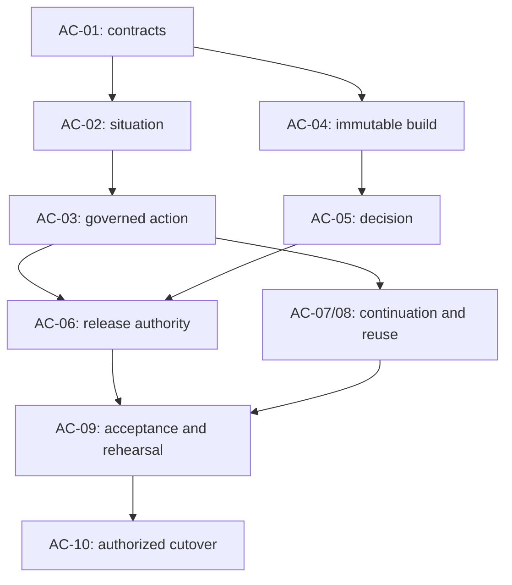

# Agent control implementation plan

Status: **DESIGN COMPLETE FOR REVIEW; IMPLEMENTATION NOT STARTED**.
Revision 2026-11-27. AC identifiers below identify delivery slices, not GitHub issue numbers.
The [issue projection](AGENT-CONTROL-ISSUES.md) maps each slice to a milestone ticket.
This plan does not change the acceptance scope or completion status of #109/#119.

## Objective and completion

Implement the [architecture](ARCHITECTURE.md) and [control contracts](AGENT-CONTROL-CONTRACTS.md)
so one directly operating agent can carry an authorized research objective to an
evidence-backed conclusion with bounded context, safe continuation and minimal
principal effort.

Completion requires observable behavior through the public interface, preservation
of existing scientific semantics, an actual authenticated principal-decision path
for protected effects, and measured operational costs. Documentation, a prototype,
passing unit tests or a green status indicator cannot establish that completion.

The existing #109/#119 review fixes, dirty work and production evidence remain
independent work. Preserve the original
[RG acceptance report](RESEARCH-GOVERNANCE-ACCEPTANCE-20261127.md) as historical evidence.
Do not rewrite that report to count this target architecture as implemented.

## Execution contract

Use one top-level objective and one direct executor. Continue through eligible
dependencies without asking the principal to sequence tickets. Deterministic
test/compute workers are optional; external coding-agent delegation is not required.

Before implementation, inspect the actual branch, diff, instructions, issue
dependencies, active runtime, canonical ledger ownership and available approval
capabilities. Record precise source/evidence identities. Preserve concurrent work;
use isolation only where needed. Never infer production state from the feature branch.

Implement vertical slices with behavior-first regression witnesses at the real
public seam. Run focused tests while changing a slice, then the required integrated
suite and compatibility checks at release candidates. Repeat tests to resolve a
specific risk or satisfy a required gate. Record failures, skips, expected failures,
warnings and untested limits separately from verified passes.

This plan authorizes no signing, push/merge, production migration, new data purchase,
sealed holdout read, trading or privileged installation. Those steps require their
own existing or future explicit authority.

## 1. Delivery slices

| ID | End-to-end outcome | Dependencies | Main existing seams | Completion evidence |
|---|---|---|---|---|
| AC-01 | A frozen vocabulary, effect catalog and behavioral fixture set | None | CLI/policy, registry, existing RG tests | Strict input/result schemas; current-to-target mapping; captured read-only baselines; every target action has authority/charge/retry semantics |
| AC-02 | One reliable situation view and resumable evidence inspection | AC-01 | Read-only projections, status/preflight, checkpoint | Cold start and resume explain actual state without migration/scoring; missing facts remain unknown; bounded output/deltas |
| AC-03 | Prepare, submit and recover one governed action through CLI and MCP | AC-02 | Admission, registry transactions, CLI/adapter | Same request produces one admitted effect; stale/conflicting requests refuse; lost response recovers receipt; existing scientific gates remain binding |
| AC-04 | Build an immutable release candidate while development remains mutable | AC-01 | Integrity, locked environment, isolated test fixtures | Exact artifact/provenance and verification bundle; unsigned build identity distinct from authorization; current runtime untouched |
| AC-05 | Present and authenticate one exact principal decision without human CLI work | AC-01, AC-04 for release packets | Existing approval gates; inspected authenticated integration | Packet identity/expiry/scope verified outside coding identity; fake/stale decisions rejected; unavailable capability explicit |
| AC-06 | Admit and activate a candidate under a bounded Release Authority | AC-03, AC-04, AC-05; separately approved bootstrap | Protected manifest/keys, runtime permissions, activation checks | Routine permitted candidate admitted; unauthorized change refused; observed runtime identity and compatible rollback; no research history reset |
| AC-07 | Drive a bounded objective with recoverable jobs and shared resource limits | AC-03 | advance, leases, evaluation kernel, deterministic worker | Partial progress survives restart; no replay on timeout/cancel; CPU/RAM/I/O budgets enforced; terminal condition stops the objective |
| AC-08 | Reuse evidence and repairs through scoped, contradiction-aware findings | AC-02, AC-03 | Outcome memory, novelty, lessons, regression fixtures | Relevant finding carries sources/limits; mandatory negative history remains complete; invalidated lesson triggers recheck |
| AC-09 | Prove integrated compatibility and rehearse production transition | AC-06, AC-07, AC-08 | Snapshot/rehearsal tools, CLI/runner/MCP, protected runtime | Full adversarial matrix, exact preservation evidence, resource measurements and reviewable cutover packet |
| AC-10 | Perform the separately authorized production transition | AC-09 plus exact principal decisions and installed capabilities | Authorized runtime and canonical state | Observed live identities/health, preserved accrued history, signed scope where required; no implied holdout/trading authorization |

All implementation rows are **NOT STARTED** in this documentation revision.

The first useful release is AC-01/02: a truthful read interface and restart packet.
The manifest-friction path is AC-04/05/06; it does not wait for a new research-memory
platform. AC-07/08 reuse the same contracts and can follow without another control
stack. AC-09 validates the whole system before AC-10.

## 2. Slice constraints that prevent a second system

### AC-01/02: observe before orchestrating

Freeze the public contract before adding aliases. Inventory existing commands and
actual effects. Reuse `ResearchRegistry(..., readonly=True)` and its narrow projections.
Fix checkpoint ledger reads through that same seam; publishing a checkpoint must
not create schema/quarantine rows. Explicitly separate observational audit logging
from scientific writes.

Keep current verdicts, exit codes and persisted semantics. New result facets are
additive. Define missing/legacy/unavailable states and use the actual source
revision rather than a count as a completeness proof.

Initial context is a situation summary and the task branch from
[CONTEXT-MAP.md](../CONTEXT-MAP.md). No unconditional full historical memory dump
is part of the target. Changes to protected startup instructions require their
own reviewed release; this documentation does not override current AGENTS.md.

### AC-03: deepen current admission

The action implementation invokes existing domain rules directly, not shell text
assembled by an LLM. Retain direct runner regression coverage for supported
non-CLI paths. Add request identity and receipt lookup at the current transaction
seam; do not store a duplicate scientific verdict in an orchestration database.

First vertical witness: submit an eligible synthetic screen, lose the response,
resume, retrieve the same receipt, and advance only if the recorded screen passed.
Prove no new candidate charge on lookup and no forced advancement on rejection.

### AC-04/05/06: remove repeated signing work

First demonstrate an unsigned immutable candidate while a different authorized
runtime remains pinned. Only then integrate a real principal-decision channel and
protected admission/activation identity. Do not start by removing check-worktree,
embedding a signing key in an agent environment, or auto-signing arbitrary branches.

Inspect the available host/connector authority before choosing the integration.
If authenticated decisions or privileged installation cannot be performed with
available capabilities, complete code, fixtures, packets and rehearsal; label
live integration blocked. Do not claim that a confirmation flag authenticates a
human or require the principal to operate a CLI as the designed normal workflow.

The principal chooses any standing grant explicitly. Begin with a narrow,
testable class of routine releases. Keep policy/verifier/authority changes outside
that class until separately authorized. Pin the trusted required checks outside
the candidate's mutable source. A candidate may add tests; it may not delete its
own release requirements.

### AC-07: preserve progress, not repeated attempts

Extend existing advance/lease behavior. Implement a durable job identity, bounded
progress, shared host limits, fencing and cancellation results. Isolate untrusted
candidate execution from canonical writes/keys where the installed trust boundary
permits it; demonstrate permissions with synthetic fixtures and dedicated test
identities. Do not describe same-UID execution as a secure sandbox.

A technical retry before admission may be cheap. A retry after uncertain scoring
or holdout claim is forbidden. Reconciliation reads and validates existing
artifacts; it does not reproduce the experiment to guess what happened.

### AC-08: improve knowledge yield

Start with existing ledger/index/lesson sources and a deterministic derived
finding index. Include off-branch outcomes and incomplete histories. Add a reusable
regression or documented remedy for a concrete recurring failure. Preserve
contradictions and retired findings with their evidence.

Display may be compact; novelty checks cannot become a top-k search. Keep the
current conservative RG-07 snapshot invalidation unless a new method demonstrates
complete discovery of relevant changes and receives the required policy review.

## 3. Behavioral acceptance matrix

All market-like execution in this matrix uses synthetic fixtures or explicitly
authorized unsealed test data. Historical-ledger checks use isolated consistent
snapshots. No production holdout is opened, hashed, sampled or permission-probed.

| ID | Scenario | Required observable result |
|---|---|---|
| A01 | Cold start in a dirty feature worktree with a different active release | Situation distinguishes checkout, dirty content, runtime and ledger identities |
| A02 | Missing ledger; old schema; unavailable runtime query | Explicit unknown/unavailable fields; no created database, DDL or false zero |
| A03 | Observe/prepare/handoff under a read-only scientific ledger | No scientific mutations, scorer calls or sealed-file I/O; declared operational logging only |
| A04 | Invalid action field, unsupported schema or capability | Typed refusal before side effect; supported next step/schema identified |
| A05 | Two concurrent candidates contend for the last hypothesis/lineage slot | At most one admission; all applicable debt and operation counts preserved |
| A06 | Same request submitted twice; same ID with changed payload | One effect for identical submission; conflict refusal for changed payload |
| A07 | Response lost after commit; process killed after reservation | Existing result retrieved, or uncertain receipt retained; no silent rerun/refund |
| A08 | Finalized rejected screen submitted through CLI, runner and MCP | Full advancement refused with the existing rejection evidence |
| A09 | Plan/code/contract/data/review changes after preparation | Relevant stale-state refusal before computation; refresh set named |
| A10 | Input bytes change after resolution; excluded symbol crosses temporal fence | Same-byte/fence safeguards still reject; no cached-metadata bypass |
| A11 | Benchmark, clock, risk/cost basis or paired evidence changes | Incremental evaluation refuses/inconclusive as governed; absolute PASS cannot override |
| A12 | Renamed candidate, changed cadence, branch failure omitted from display | Existing alias/lineage/selection debt and mandatory novelty checks still apply |
| A13 | Fake principal name, copied chat text, changed packet or expired/revoked grant | No release, policy change or protected action is authorized |
| A14 | Candidate changes its tests, verifier or classification of its own edit | Trusted baseline remains binding; unsupported release class requires a decision |
| A15 | Development inventory becomes stale while an authorized runtime is active | Development diagnostics remain usable; runtime identity/authority unchanged |
| A16 | Late worker, duplicate result, cancel/lease expiry during execution | Fencing rejects stale finalization; actual effect known or explicitly uncertain |
| A17 | Activation fails; old binary cannot read newly accrued ledger state | Compatible rollback or affected-operation halt; no database/history rewind |
| A18 | Unknown legacy exposure; changed holdout pin; crash before/after read-start | Existing scope/claim refusals or spent/uncertain incident remain; no information refund |
| A19 | Retrieved lesson contradicted by newer scoped evidence | Both sources preserved; applicability re-evaluated; no automatic policy mutation |
| A20 | Small context budget or paginated history | Explicit completeness/cursors; no hidden blocker or missing mandatory negative gate |
| A21 | Multiple jobs exceed CPU/RAM/I/O quota or a job stops heartbeating | Bounded scheduling/termination, accurate resource receipt, conservative scientific state |
| A22 | Public old/new interface over the same historical fixture | Equivalent stored identities/verdicts/debt; backward-compatible exit/sentinel behavior |
| A23 | Principal receives a protected-action packet through the installed integration | Exact authenticated decision consumed; zero principal CLI commands; wrong-subject action denied |
| A24 | Available authenticated/privileged integration is absent | Concrete prepared packet and explicit capability blocker; no invented authorization |
| A25 | Full integration test and migration rehearsal | Concurrent work, protected files, original database/evidence and sealed data remain unchanged |

A01–A04/20 belong to AC-02; A05–A12/22 to AC-03; A13–A15/17/23/24
to AC-04/05/06; A16/21 to AC-07; A12/19/20 to AC-08. A18/25 are required
again at AC-09 with the existing RG holdout/exposure and migration suites.

## 4. Measure ergonomics and resource cost

These are proposed engineering acceptance targets, not measured results.

| Measure | Initial target and evaluation |
|---|---|
| Cold-start state acquisition | One default situation request identifies objective, scope, authority, blockers and next actions |
| Default context size | At most 12 KiB of summary JSON, with explicit pagination/omission; detailed evidence requested separately |
| Cheap observation | Zero evaluator invocations, scientific writes, full dataset reads or sealed-file reads |
| Retry waste | Zero duplicate scientific admissions/computations in lost-response and duplicate-submit fixtures |
| Human mechanics | Zero required human CLI commands through the installed approval/release path |
| Approval repetition | Unchanged, unexpired scoped decision reused; reapproval only when its bound inputs or scope change |
| Knowledge reuse | Seeded prior failure/repair discovered with provenance and limits; mandatory negatives remain complete |
| Compute/I/O | Record elapsed time, CPU, peak RSS, bytes hashed/read and cache hits on representative workloads |
| Byte-verification overhead | Compare current behavior against bounded streaming/staging on largest authorized unsealed datasets; show incremental verification memory separately from parser/model memory |
| Host contention | Measure foreground observation latency and memory under concurrent bounded jobs; no unconstrained nested thread pools |

Measure baselines before optimizing. Set latency thresholds from that baseline
and the actual VPS/resource budget; do not invent “10x” gains. A performance change
must preserve byte identity, temporal fences, recorded counts and outcome semantics.
Skip a new cache/worker/service if it cannot demonstrate lower total cost after
including invalidation, operational effort and auditability.

## 5. Migration and cutover sequence

### Rehearsal: authorized engineering scope

1. Inventory exact source/dependency/policy identities and all dirty/untracked
   concurrent work that could be affected. Locate the actual live runtime and
   registry through authorized metadata only.
2. Take a consistent isolated SQLite snapshot using the existing backup tooling.
   Preserve the original database/WAL and evidence artifacts. Do not copy a live
   WAL database as though the main file alone were a consistent snapshot.
3. Run the one canonical additive migration on the snapshot. Compare every
   previously existing table/column/value, immutable digest, trial/operation ID,
   selection floor, claim and exposure. New rows must have explicit provenance.
4. Reconcile local-only contract/hypothesis references from the #119 acceptance
   report. Do not silently drop, import, requalify or rewrite them.
5. Preserve unknown historical exposure as unknown. Prepare an evidence inventory;
   the principal supplies any required history attestation without opening sealed
   data to discover its scope.
6. Exercise compatible upgrade, activation failure, rollback/forward repair and
   resumption using scratch artifacts and receipts. Validate old readers that are
   still supported.
7. Produce one cutover packet: exact release, verification results/omissions,
   migration diff and evidence preservation, authority requirements, resource
   measurements, observation plan and compatible rollback.

### Live execution: separately authorized scope

8. Obtain the exact release/installation/migration decisions required by the
   proposed effects. A standing grant covers only what it actually names.
9. Quiesce incompatible writers through the authorized interface, take the
   required backup, apply the approved migration and activate the exact release.
   Record each committed effect and reconcile interruption before continuing.
10. Verify actual executable identity, policy/grant state, registry compatibility,
    read-only status and health. Preserve all newly accrued history on rollback.
11. Resume only already-authorized research. Historical exposure reconciliation,
    frozen-batch authorization and holdout reading remain distinct actions;
    cutover alone grants none of them.

No approval is requested merely to draft this packet. Ask for a decision only
after the authorized preparation has made its consequences reviewable.

## 6. Known prerequisites and explicit design choices

| Item | Disposition |
|---|---|
| Current protected manifest is stale | Existing blocker retained; the target removes recurrence only after Release Authority is installed |
| Production migration/history reconciliation | Outstanding; rehearsal and exact decisions precede live effects |
| New standing delegation scope | Principal decision at AC-05/06; conservative current rules until then |
| Authenticated approval channel and protected installer | UNKNOWN; inspect actual capabilities before choosing mechanism |
| Largest-dataset read-time memory overhead | UNKNOWN; benchmark authorized unsealed inputs in AC-09 |
| Independent conformance | Existing requirement retained; JUDGE_UNAVAILABLE cannot be self-approved |
| Current application vs OS trust boundary | Document honestly; demonstrate any stronger boundary with actual permissions |
| Current user workflow | ChatGPT directs and executes; no human coding/CLI burden in the target; no mandatory external agents |

Decisions settled for the design: reuse Warden/ML4T/SQLite; one typed control
implementation; immutable evidence; separate release authority; receipts before
retry; bounded progressive context; scoped findings; conservative approvals.
No unresolved engineering choice requires asking the user to perform a command.

## 7. Completion report

For every delivered slice report IMPLEMENTED, VERIFIED and DEPLOYED separately,
with exact commit/content identity, tests and omission counts, observed effects,
remaining blockers and authority references. Scientific qualification is its own
claim supported only by governed evidence.

The final program report must account for every A01–A25 scenario and resource
measure, name the actual installed capabilities, and state which production
decisions remain pending. Stop optional work once the objective and required
verification are complete; retain a durable resume packet for a genuine blocker.
