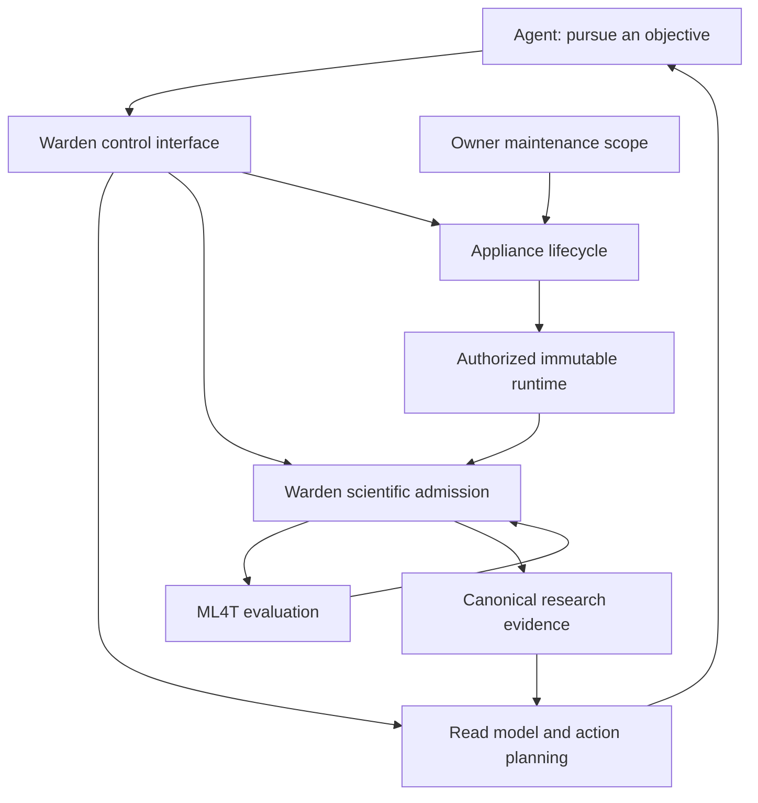

# Quant-Lab architecture: evidence-driven agent control

Status: **APPROVED — trusted research appliance amendment, 2026-11-27**.
See [implemented operations and boundaries](AGENT-CONTROL-OPERATIONS.md) and the
[accepted amendment](adr/2026-11-27-trusted-research-appliance.md) for maintenance authority and scientific exclusions.
Grounded in `feat/119-research-governance` at `8fb7180` plus the uncommitted
governance review fixes. The current procedure is [WORKFLOW.md](WORKFLOW.md);
[AGENTS.md](../AGENTS.md) and explicit principal authorization still govern operations.

## 1. Purpose and optimization order

Quant-Lab should let one agent pursue a research objective, understand exactly
what is known, choose the next justified action, and verify its effect without
reconstructing the system from command output. The principal sets objectives and
authority through explicit instructions; the agent handles authorized maintenance and execution.
Scientific protected effects retain their existing distinct approval and evidence requirements.

Optimize in this order:

1. Preserve scientific validity, evidence history, and the principal's authority.
2. Make uncertainty, stale observations, contradictions, and partial completion visible.
3. Reach a justified decision with the fewest irreversible information exposures.
4. Reuse valid evidence and computation; spend resources only to resolve a relevant uncertainty.
5. Turn useful discoveries into scoped, verifiable knowledge that improves later work.

A rejected thesis can be a successful objective outcome. Passing tests, running
more backtests, filling every budget slot, and maximizing reported Sharpe are
not optimization targets. Economic qualification and trading authorization remain
separate from engineering success.

An agent should be able to answer five questions from one bounded situation view:
**Where am I? What is true? What am I allowed to do? What is worth doing next?
How will I know that it worked?**

## Current research-operation ownership

The lifecycle is resolve the frozen subject and approvals → reserve once → compute
through ML4T → commit evidence → inspect or reconcile the original receipt.

| Owner | Canonical responsibility |
|---|---|
| `ExperimentRunner.advance_spec` | Idempotent per-spec progression, stop/review decisions and the selected ledger's writer lease |
| `ExperimentRunner.verify_spec`, `run_stage1_screen`, `run_spec`, `audit_run` | Scientific operations; screen and trial share one preparation path and screen finalization has one publication site |
| `ResearchRegistry` | Frozen hypothesis/intent, admission, atomic evidence persistence, one lifecycle projection and original-request recovery |
| `EvaluationKernel` | Native ML4T computation and within-operation tape reuse |
| CLI, typed control and queued jobs | Rendering, request identity, stale-plan checks and bounded process ownership around those same scientific operations |

`read_spec_status` is metadata-only and explicitly non-authoritative about artifact
integrity. `spec_status` retains artifact reconciliation before progression.
A hypothesis, candidate, operation, control request and job remain distinct because
their budgets, effects and recovery obligations differ.

The redundant `scripts/run_spec_session.py` funnel is retired. Use the installed
launcher's `advance` for progression, or typed control actions and jobs for explicit
operations. Internal callers use runner methods directly; they do not call CLI
handlers or parse their output. Historical reports describing the retired script
remain historical evidence.

See [the architectural decision and verification record](ARCHITECTURAL-UNTANGLING-20261128.md)
for the deletion test, preserved invariants, measurements and limits.

## 2. Pre-AC implementation baseline and the seams to deepen

These are observations of the design baseline, not claims about the running production deployment. The implementation guide above records subsequent AC changes.

| VERIFIED foundation | Friction visible in the current interface | Target change |
|---|---|---|
| [CLI](../src/warden/cli.py) exposes status, spec/attempt state, advance, intent, review and batch commands | Callers assemble several partial views; transport completion and scientific outcomes use different shapes | One versioned situation/action/receipt contract over the existing domain operations |
| [Read-only projections](../src/warden_ops/readonly.py) use an existing ledger without migrations | Missing data and unavailable fields need explicit interpretation; the separate [checkpoint builder](../src/warden_ops/checkpoint.py) still constructs a mutable registry | One read model; checkpoint publication never initializes or migrates the scientific ledger |
| [Admission](../src/warden/candidate_admission.py), [intent](../src/warden/research_intent.py), [registry](../src/warden/registry.py) and [exposure](../src/warden/exposure.py) already own scientific transitions | An agent must discover ordering, debts and recovery rules across those modules and documents | Warden computes eligible actions and dependency explanations from those same rules |
| [Integrity](../src/warden_ops/integrity.py) binds protected bytes; CLI manifest generation requires approval | Mutable source work and release authorization share one manifest lifecycle | Immutable release candidates, mechanically generated inventories, and owner-delegated verified maintenance lifecycle |
| [Outcome memory](../src/warden_ops/research_outcome_memory.py) and [novelty](../src/warden/novelty.py) retain prior failures | A long historical inventory is expensive context; retrieved summaries can lose applicability or authority | Bounded evidence views with completeness metadata, contradiction links and explicit applicability |
| [MCP adapter](../scripts/mcp_warden/adapter.py) restricts commands and paths | Generic command/flags plus mixed-output parsing; a timeout requires manual reconstruction | Typed operations, stable request identity, bounded progress and receipt lookup |

The work deepens existing seams. It retains the #109 DataRequirement, resolver,
compiler, venue policy and selection groups; #119 intent, admission, accounting,
benchmark, novelty and exposure controls; ML4T computation; and the canonical
research registry. No second scientific runner, policy file or research ledger
is introduced.

The original [RFC](archive/agent_native_quant_research_rfc.md) is historical
context. This document is the prospective system design. Dated acceptance
reports describe their recorded runs, never the current host state.

## 3. The abstraction tower

Each layer exposes a small interface and hides the ordering and bookkeeping
owned below it. This is a dependency model, not a plan for six deployed services.

| Layer | Domain object the agent reasons about | Responsibility |
|---|---|---|
| Objective | A question, completion criterion, permitted scope and resource ceiling | Preserve the user's goal across sessions; stop when evidence resolves it |
| Situation | A bounded, attributed view of facts, unknowns, authority and available actions | Make current reality legible without pretending observations are globally atomic |
| Action plan | Typed actions with prerequisites, expected effects, costs and stop conditions | Explain and prepare work before spending research budget or requiring a decision |
| Governed operation | A single admitted transition with a durable receipt | Check authority and identities, reserve, execute, finalize, reconcile |
| Domain implementation | Data resolution, scientific evaluation, release admission, exposure accounting | Enforce each invariant once through its existing owner |
| Evidence and authority | Immutable artifacts, research history, scientific approvals and maintenance receipts | Establish what happened, what it means, and what is permitted |

Authority is an independent input to the tower. Evidence can satisfy a condition
of an existing grant; it cannot create a grant. A situation view and a learned
lesson are derived views, never permission to mutate research history.

**Warden control** is a deep application interface, not an autonomous scientific
judge. The agent selects and explains actions; deterministic Warden rules decide
whether a scientific action may execute. The appliance owns verified software maintenance;
its receipts cannot satisfy scientific conformance, exposure or trading requirements.

## 4. The agent's operating loop

1. **Observe.** Load the current objective and a situation view. Reconcile actual
   checkout, active runtime, canonical ledger, policy and outstanding receipts.
   Label missing observations as unknown.
2. **Inspect only the relevant branch.** Fetch the evidence and domain guidance
   needed for the next decision. Preserve mandatory novelty/history checks even
   when their display is compact.
3. **Prepare.** Obtain a typed plan with exact subjects, prerequisite versions,
   prospective resource and research charges, expected artifacts and terminal
   conditions. Preparation produces no new market-strategy performance.
4. **Act within authority.** Execute eligible actions under the current grant.
   Submit a concrete decision packet when additional authority is necessary.
   Continue independent eligible work while that decision is pending.
5. **Verify the effect.** Read the durable receipt and its evidence, then refresh
   affected observations. A process exit or successful transport is insufficient.
6. **Accumulate useful knowledge.** Record a supported finding, its limits and
   reuse conditions. Resume from receipts after interruption; finish on the
   objective's evidence condition rather than on a tool-call count.

Normal unattended progression is bounded by the objective, current authority,
compute limits and scientific stop conditions. It never requires the user to
issue “next” per ticket. It never creates independent reviewers, purchases data,
or expands research scope simply because an action is blocked.

### Example: a rejected candidate

The receipt records a finalized Stage-1 REJECT and the charged candidate.
The next situation view offers explanation, authorized closure or another
already-approved distinct thesis. It does not offer a forced full backtest.
If an engineering repair is indicated, the plan states whether it changes
candidate identity and requires a new governed revision. Renaming the spec or
retrieving the receipt cannot refund the prior attempt.

### Example: a lost response

The agent looks up the existing request. A finalized operation returns the
existing evidence. A running operation returns bounded progress. An uncertain
admission enters reconciliation. The agent never creates a new request ID merely
to bypass a timeout. A new shell process is not evidence that the old work failed.

### Example: an evaluator fix makes the worktree manifest stale

Refresh unsigned maintenance checksums in the isolated development checkout, run the
required verification, then install a new immutable runtime through the appliance lifecycle.
The current runtime stays pinned throughout development. Evaluator fixes preserve scientific
semantics; changing those semantics or approving a scientific effect still needs its existing
scientific authority. Deployment alone grants no historical attestation or holdout access.

## 5. State, identity and knowledge

The [glossary](../CONTEXT.md) distinguishes hypothesis, candidate, operation,
selection group, lineage and exposure scope. These identities serve different
purposes; no new “experiment ID” collapses them.

The situation view keeps four independent dimensions:

| Dimension | Typical questions |
|---|---|
| Execution | Was work proposed, reserved, running, finalized, refused or uncertain? |
| Evidence | Is the claim verified, inferred, hypothetical or unknown? Which exact evidence supports it? |
| Scientific standing | Is evidence synthetic, exploratory, proxy-only, inconclusive, development-passing or qualified? |
| Authority | Which action is permitted, by whom, over which identity and until when? |

These are target presentation facets; existing persisted verdicts and numeric
gates retain their meanings. A green engineering field cannot upgrade a
scientific or authority field.

A snapshot records source revisions and observation times. SQLite, Git, a lake
catalog and an operating-system process are different clocks. A version vector
and a “mixed/stale/unavailable” designation are more honest than one timestamp.
Execution revalidates the relevant revisions through the operation owner.
Unrelated operational changes need not invalidate every plan, but existing
RG-07 novelty invalidation remains conservative until a separately reviewed
completeness-preserving replacement exists.

See [the control contracts](AGENT-CONTROL-CONTRACTS.md) for the exact required
information, refusal semantics, concurrency and evidence publication rules.

## 6. Trusted research appliance and effect-based governance

The [accepted amendment](adr/2026-11-27-trusted-research-appliance.md) replaces independent
software-release authentication with owner-delegated maintenance. The personal single-owner
system protects against accidental agent errors, not a malicious actor with unrestricted host
control. A separate same-host signer would not establish independence under that threat model.

Keep three distinct objects: a content-addressed source/dependency inventory, deterministic
verification evidence, and a durable lifecycle receipt. The receipt records maintenance under
the owner's accepted scope. It is neither independent conformance nor scientific approval.

One local lifecycle owner prepares a sparse pinned Git runtime, verifies it against the frozen
candidate, pauses configured writers, rehearses the canonical additive migration, and checks
all pre-existing evidence. Intent precedes live effects; the runtime pointer changes atomically.
The actual executable reports its module root, release and ledger schema through a read-only
probe. Both existing writer locks serialize cutover. Lost responses recover receipts.

The canonical registry and evidence stay in place. A backup cannot erase later accrued history.
Recovery uses a compatible runtime or halts the affected launcher. Development work remains
separate, so editing its checksum inventory cannot alter deployed code.

Scientific rules, intent, independent review, promotion, historical attestations, sealed batches,
holdout access and trading retain their existing authority. The signed scientific-policy reader
stays strict; maintenance creates no signature. Retain JUDGE_UNAVAILABLE where genuine
independent evidence is absent. Ordinary maintenance proceeds without inventing that evidence.

## 7. Make each session improve the next

Accretion has three destinations:

| New information | Durable destination | Reuse rule |
|---|---|---|
| Scientific outcome, attempt or exposure | Existing canonical registry and immutable artifact | Preserve identity and debt; assess applicability before drawing a new conclusion |
| Engineering failure mode or repair | Focused regression, fixture or recovery procedure, linked to the incident | Reuse after checking affected versions and assumptions |
| Research lesson or domain insight | Evidence-linked finding indexed through existing outcome-memory/novelty sources | Retrieve as a scoped claim with supporting and contradicting evidence |

A finding contains the question, claim, evidence references, decision cutoff,
applicability, limitations, contradiction/supersession links and the condition
that would require rechecking it. A summary cannot retroactively change an
outcome or convert an association into independent evidence.

Operational observations expire or are refreshed. Durable lessons remain
discoverable without being injected into every prompt. The initial implementation
uses deterministic indexes and existing SQLite/JSON/Markdown sources. A vector
database, new memory server and an LLM on every status call are unnecessary.

Promote a recurring lesson into a test, template or documented default when it
has a clear invariant and supporting evidence. Changes affecting scientific
policy still pass the policy decision path. Memory grows in usefulness while the
agent's required starting context stays bounded.

## 8. Resource discipline

Treat candidate allowance, selection debt, compute, data acquisition, agent
context and holdout exposure as different budgets. Compute can be replenished;
consumed evidence does not become unseen.

| Resource | Default design |
|---|---|
| Context | Small situation view, task-specific document pointers, explicit pagination and deltas |
| Compute | Cheapest valid check first; bounded jobs, shared CPU/RAM quotas and cancellation semantics |
| I/O | Metadata-only observation; explicit validation tiers; no full dataset hash on every status request |
| Reuse | Cache exact authorized computation identities, including failed outcomes; re-read receipts before rerunning |
| Review | Prepare complete packets, reuse unchanged approvals within their scope, ask only for a new decision |
| Research | Stop on decisive failure or lack of a justified revision; count every admitted selectable choice |
| Information exposure | Treat holdout access as irreversible; never probe it to discover availability or permissions |

Caching exact dataset verification is safe only when it refers to an actually
immutable object protected from the agent and concurrent writers. Size/mtime,
a filename or a previous hash is not proof of unchanged bytes. For mutable input,
verify the same byte stream used by the parser; bounded-memory staging or another
verified ingestion method must preserve that guarantee. Benchmark large *unsealed*
datasets before claiming a memory improvement. The current read-time byte check
remains in force until a replacement is verified.

Choose the next action by expected decision value, prerequisite availability,
reusability and cost. Record the reason. Do not invent a numerical “information
gain” score when it cannot be calibrated, or turn expected-value ranking into
adaptive selection on frozen validation/holdout outcomes.

## 9. Deployment shape and trust limits

Use the existing Python application, SQLite/Parquet, Git, locked environment and local worker.
The appliance is an on-demand CLI runtime with one append-only operational journal. CLI/MCP
continue to call the same Warden science owners. No new daemon, signer, privileged installer,
workflow platform or external coding-agent delegation is required.

Source artifacts and the pinned execution worktree are separate from canonical state. Bind
only the registry, unsealed exploratory data, cache and hypothesis documents. Do not install a
sealed-data mount or discover/read sealed files. Frozen checksums, runtime observation and
readonly source modes detect accidental drift; they are not a hostile-agent security boundary.
Host permissions remain binding. Tests establish the recorded scope, not independent review.

Existing job isolation/resource limits remain useful against accidents. Accessible validation
data can still be used for undeclared search by a malicious owner; intent, conformance,
causality and append-only accounting remain necessary scientific controls.

## 10. Delivery and evidence

The [implementation plan](AGENT-CONTROL-PLAN.md) retains the behavioral matrix with the narrow
A13/A14/A24 amendment and explicit A23 supersession. The [appliance ADR](adr/2026-11-27-trusted-research-appliance.md)
records the decision and effect exclusions. The original AC ADR and dated pre-amendment
acceptance/cutover reports retain their original blocked status as historical evidence.

Read [operations](AGENT-CONTROL-OPERATIONS.md) before release, migration or recovery. Read
current lifecycle receipts for deployed identity; a branch name or old acceptance report is
not runtime observation. Source integration, engineering verification, deployment and scientific
qualification are separate facts. No maintenance outcome ratifies missing scientific history.
