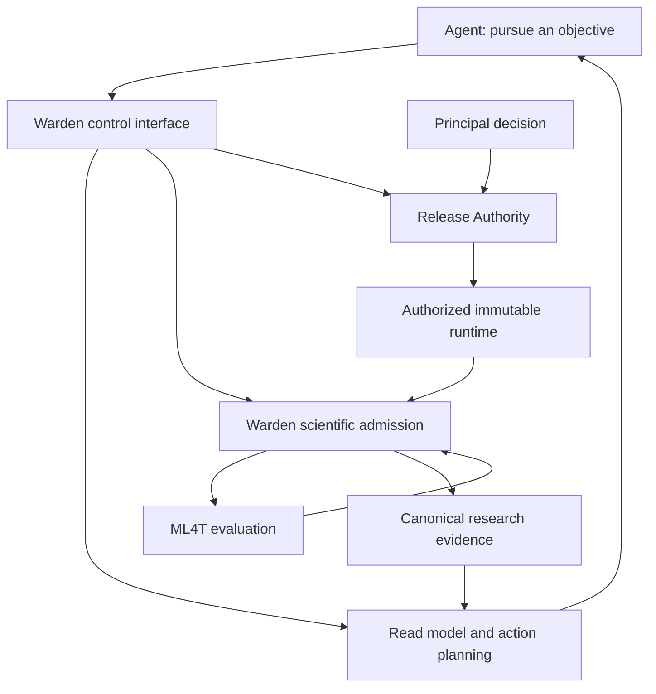

# Quant-Lab architecture: evidence-driven agent control

Status: **APPROVED TARGET DESIGN — source implementation is documented separately; production is not authorized**. Revised 2026-11-27.
See [implemented operations and boundaries](AGENT-CONTROL-OPERATIONS.md) for AC-01–09 source behavior and unavailable authority integration.
Grounded in `feat/119-research-governance` at `8fb7180` plus the uncommitted
governance review fixes. The current procedure is [WORKFLOW.md](WORKFLOW.md);
[AGENTS.md](../AGENTS.md) and explicit principal authorization still govern operations.

## 1. Purpose and optimization order

Quant-Lab should let one agent pursue a research objective, understand exactly
what is known, choose the next justified action, and verify its effect without
reconstructing the system from command output. The principal sets objectives and
authority through an authenticated decision interface; the agent handles execution.

Optimize in this order:

1. Preserve scientific validity, evidence history, and the principal's authority.
2. Make uncertainty, stale observations, contradictions, and partial completion visible.
3. Reach a justified decision with the fewest irreversible information exposures.
4. Reuse valid evidence and computation; spend resources only to resolve a relevant uncertainty.
5. Turn useful discoveries into scoped, verifiable knowledge that improves later work.

A rejected thesis can be a successful objective outcome. Passing tests, running
more backtests, filling every budget slot, and maximizing reported Sharpe are
not optimization targets. Economic qualification and trading authorization remain
separate from engineering success.

An agent should be able to answer five questions from one bounded situation view:
**Where am I? What is true? What am I allowed to do? What is worth doing next?
How will I know that it worked?**

## 2. Pre-AC implementation baseline and the seams to deepen

These are observations of the design baseline, not claims about the running production deployment. The implementation guide above records subsequent AC changes.

| VERIFIED foundation | Friction visible in the current interface | Target change |
|---|---|---|
| [CLI](../src/warden/cli.py) exposes status, spec/attempt state, advance, intent, review and batch commands | Callers assemble several partial views; transport completion and scientific outcomes use different shapes | One versioned situation/action/receipt contract over the existing domain operations |
| [Read-only projections](../src/warden_ops/readonly.py) use an existing ledger without migrations | Missing data and unavailable fields need explicit interpretation; the separate [checkpoint builder](../src/warden_ops/checkpoint.py) still constructs a mutable registry | One read model; checkpoint publication never initializes or migrates the scientific ledger |
| [Admission](../src/warden/candidate_admission.py), [intent](../src/warden/research_intent.py), [registry](../src/warden/registry.py) and [exposure](../src/warden/exposure.py) already own scientific transitions | An agent must discover ordering, debts and recovery rules across those modules and documents | Warden computes eligible actions and dependency explanations from those same rules |
| [Integrity](../src/warden_ops/integrity.py) binds protected bytes; CLI manifest generation requires approval | Mutable source work and release authorization share one manifest lifecycle | Immutable release candidates, mechanically generated inventories, and separately scoped release authorization |
| [Outcome memory](../src/warden_ops/research_outcome_memory.py) and [novelty](../src/warden/novelty.py) retain prior failures | A long historical inventory is expensive context; retrieved summaries can lose applicability or authority | Bounded evidence views with completeness metadata, contradiction links and explicit applicability |
| [MCP adapter](../scripts/mcp_warden/adapter.py) restricts commands and paths | Generic command/flags plus mixed-output parsing; a timeout requires manual reconstruction | Typed operations, stable request identity, bounded progress and receipt lookup |

The work deepens existing seams. It retains the #109 DataRequirement, resolver,
compiler, venue policy and selection groups; #119 intent, admission, accounting,
benchmark, novelty and exposure controls; ML4T computation; and the canonical
research registry. No second scientific runner, policy file or research ledger
is introduced.

The original [RFC](archive/agent_native_quant_research_rfc.md) is historical
context. This document is the prospective system design. Dated acceptance
reports describe their recorded runs, never the current host state.

## 3. The abstraction tower

Each layer exposes a small interface and hides the ordering and bookkeeping
owned below it. This is a dependency model, not a plan for six deployed services.

| Layer | Domain object the agent reasons about | Responsibility |
|---|---|---|
| Objective | A question, completion criterion, permitted scope and resource ceiling | Preserve the user's goal across sessions; stop when evidence resolves it |
| Situation | A bounded, attributed view of facts, unknowns, authority and available actions | Make current reality legible without pretending observations are globally atomic |
| Action plan | Typed actions with prerequisites, expected effects, costs and stop conditions | Explain and prepare work before spending research budget or requiring a decision |
| Governed operation | A single admitted transition with a durable receipt | Check authority and identities, reserve, execute, finalize, reconcile |
| Domain implementation | Data resolution, scientific evaluation, release admission, exposure accounting | Enforce each invariant once through its existing owner |
| Evidence and authority | Immutable artifacts and research history; separately protected grants and release attestations | Establish what happened, what it means, and what is permitted |

Authority is an independent input to the tower. Evidence can satisfy a condition
of an existing grant; it cannot create a grant. A situation view and a learned
lesson are derived views, never permission to mutate research history.

**Warden control** is a deep application interface, not an autonomous scientific
judge. The agent selects and explains actions; deterministic Warden rules decide
whether an action may execute. The Release Authority has a separately controlled
identity because the proposer must not be able to grant itself release authority.

## 4. The agent's operating loop

1. **Observe.** Load the current objective and a situation view. Reconcile actual
   checkout, active runtime, canonical ledger, policy and outstanding receipts.
   Label missing observations as unknown.
2. **Inspect only the relevant branch.** Fetch the evidence and domain guidance
   needed for the next decision. Preserve mandatory novelty/history checks even
   when their display is compact.
3. **Prepare.** Obtain a typed plan with exact subjects, prerequisite versions,
   prospective resource and research charges, expected artifacts and terminal
   conditions. Preparation produces no new market-strategy performance.
4. **Act within authority.** Execute eligible actions under the current grant.
   Submit a concrete decision packet when additional authority is necessary.
   Continue independent eligible work while that decision is pending.
5. **Verify the effect.** Read the durable receipt and its evidence, then refresh
   affected observations. A process exit or successful transport is insufficient.
6. **Accumulate useful knowledge.** Record a supported finding, its limits and
   reuse conditions. Resume from receipts after interruption; finish on the
   objective's evidence condition rather than on a tool-call count.

Normal unattended progression is bounded by the objective, current authority,
compute limits and scientific stop conditions. It never requires the user to
issue “next” per ticket. It never creates independent reviewers, purchases data,
or expands research scope simply because an action is blocked.

### Example: a rejected candidate

The receipt records a finalized Stage-1 REJECT and the charged candidate.
The next situation view offers explanation, authorized closure or another
already-approved distinct thesis. It does not offer a forced full backtest.
If an engineering repair is indicated, the plan states whether it changes
candidate identity and requires a new governed revision. Renaming the spec or
retrieving the receipt cannot refund the prior attempt.

### Example: a lost response

The agent looks up the existing request. A finalized operation returns the
existing evidence. A running operation returns bounded progress. An uncertain
admission enters reconciliation. The agent never creates a new request ID merely
to bypass a timeout. A new shell process is not evidence that the old work failed.

### Example: an evaluator fix makes the worktree manifest stale

Development can produce a new unsigned build inventory and engineering evidence
in isolation. The active authorized runtime remains pinned. The Release Authority
either admits the exact candidate within an explicit standing grant or returns
a prepared decision packet. Approval of a release does not approve production
migration, historical exposure reconciliation or holdout access.

## 5. State, identity and knowledge

The [glossary](../CONTEXT.md) distinguishes hypothesis, candidate, operation,
selection group, lineage and exposure scope. These identities serve different
purposes; no new “experiment ID” collapses them.

The situation view keeps four independent dimensions:

| Dimension | Typical questions |
|---|---|
| Execution | Was work proposed, reserved, running, finalized, refused or uncertain? |
| Evidence | Is the claim verified, inferred, hypothetical or unknown? Which exact evidence supports it? |
| Scientific standing | Is evidence synthetic, exploratory, proxy-only, inconclusive, development-passing or qualified? |
| Authority | Which action is permitted, by whom, over which identity and until when? |

These are target presentation facets; existing persisted verdicts and numeric
gates retain their meanings. A green engineering field cannot upgrade a
scientific or authority field.

A snapshot records source revisions and observation times. SQLite, Git, a lake
catalog and an operating-system process are different clocks. A version vector
and a “mixed/stale/unavailable” designation are more honest than one timestamp.
Execution revalidates the relevant revisions through the operation owner.
Unrelated operational changes need not invalidate every plan, but existing
RG-07 novelty invalidation remains conservative until a separately reviewed
completeness-preserving replacement exists.

See [the control contracts](AGENT-CONTROL-CONTRACTS.md) for the exact required
information, refusal semantics, concurrency and evidence publication rules.

## 6. Release authority and a principal who uses chat

Three objects replace the overloaded concept of “the signed worktree”:

- **Build identity:** reproducible inventory of the candidate's exact source,
  dependencies, configuration and contract/policy references.
- **Verification evidence:** observed checks of those bytes, including failed,
  skipped, expected-failure and untested areas, with the verifier's identity.
- **Release authorization:** permission from a protected authority to activate
  that build under a specific policy and delegation scope.

Mechanical hashing is autonomous. Authorization follows a grant, which can
cover a bounded class of routine releases. A change outside that class produces
one reviewable decision packet. Changes to scientific rules, trusted verification,
authority, key custody, or exposure permissions are classified conservatively.

The decision interface presents consequences, evidence, remaining uncertainty,
rollback feasibility, exact subject digest and expiry. The principal approves or
declines in an authenticated interaction. A trusted adapter binds that decision
to the packet; the agent carries out the permitted mechanics. Typing a principal
name, copying a chat sentence, or setting a “human confirmed” flag cannot mint
authority.

**This authenticated approval adapter and protected release installation are
not verified as available.** Provisioning them is an explicit implementation
dependency. Until they exist, current gates remain binding. An unavailable
operator capability is reported as such; the system does not ask the principal
to debug Python or invent a shell-based workaround.

A standing grant is a deliberate principal decision, not inferred from this
document or the request to improve ergonomics. Tests are fallible evidence;
passing candidate-authored tests alone cannot authorize arbitrary evaluator
changes. Admission uses a protected baseline of required checks and an explicitly
accepted risk scope. Unclassifiable changes escalate.

Release rollout changes the executable runtime, not the scientific record.
Rollback retains all claims, exposures, revisions and debt accrued since
activation. An older binary unable to read current evidence cannot be activated;
use a compatible forward repair or halt the affected operations.

## 7. Make each session improve the next

Accretion has three destinations:

| New information | Durable destination | Reuse rule |
|---|---|---|
| Scientific outcome, attempt or exposure | Existing canonical registry and immutable artifact | Preserve identity and debt; assess applicability before drawing a new conclusion |
| Engineering failure mode or repair | Focused regression, fixture or recovery procedure, linked to the incident | Reuse after checking affected versions and assumptions |
| Research lesson or domain insight | Evidence-linked finding indexed through existing outcome-memory/novelty sources | Retrieve as a scoped claim with supporting and contradicting evidence |

A finding contains the question, claim, evidence references, decision cutoff,
applicability, limitations, contradiction/supersession links and the condition
that would require rechecking it. A summary cannot retroactively change an
outcome or convert an association into independent evidence.

Operational observations expire or are refreshed. Durable lessons remain
discoverable without being injected into every prompt. The initial implementation
uses deterministic indexes and existing SQLite/JSON/Markdown sources. A vector
database, new memory server and an LLM on every status call are unnecessary.

Promote a recurring lesson into a test, template or documented default when it
has a clear invariant and supporting evidence. Changes affecting scientific
policy still pass the policy decision path. Memory grows in usefulness while the
agent's required starting context stays bounded.

## 8. Resource discipline

Treat candidate allowance, selection debt, compute, data acquisition, agent
context and holdout exposure as different budgets. Compute can be replenished;
consumed evidence does not become unseen.

| Resource | Default design |
|---|---|
| Context | Small situation view, task-specific document pointers, explicit pagination and deltas |
| Compute | Cheapest valid check first; bounded jobs, shared CPU/RAM quotas and cancellation semantics |
| I/O | Metadata-only observation; explicit validation tiers; no full dataset hash on every status request |
| Reuse | Cache exact authorized computation identities, including failed outcomes; re-read receipts before rerunning |
| Review | Prepare complete packets, reuse unchanged approvals within their scope, ask only for a new decision |
| Research | Stop on decisive failure or lack of a justified revision; count every admitted selectable choice |
| Information exposure | Treat holdout access as irreversible; never probe it to discover availability or permissions |

Caching exact dataset verification is safe only when it refers to an actually
immutable object protected from the agent and concurrent writers. Size/mtime,
a filename or a previous hash is not proof of unchanged bytes. For mutable input,
verify the same byte stream used by the parser; bounded-memory staging or another
verified ingestion method must preserve that guarantee. Benchmark large *unsealed*
datasets before claiming a memory improvement. The current read-time byte check
remains in force until a replacement is verified.

Choose the next action by expected decision value, prerequisite availability,
reusability and cost. Record the reason. Do not invent a numerical “information
gain” score when it cannot be calibrated, or turn expected-value ranking into
adaptive selection on frozen validation/holdout outcomes.

## 9. Deployment shape and trust limits

Start with one Python application and its existing SQLite/Parquet storage.
CLI, MCP and any future UI are adapters to the same control implementation.
Use a deterministic local worker for long jobs; external workers are optional
and receive only authorized inputs. The agent remains the direct executor.

The Release Authority is the one necessary separate trust identity. It owns
release admission, protected grants and activation records. The research registry
continues to own scientific history. Referencing authority receipts from research
records does not duplicate either source of truth.

The current #119 boundary is governed application entry points. Same-UID shell
access, mutable evaluator code, direct writable SQLite or arbitrary strategy
execution are not made safe by an API wrapper. The target isolates signing and
activation first. Moving candidate execution to an unprivileged worker can then
protect ledger writes and sealed files; tests must demonstrate actual permissions.
Even isolated code with accessible validation data can perform undeclared search,
so intent, conformance and accounting controls remain necessary. Do not claim a
general hostile-code sandbox from AST checks or process separation alone.

There is no requirement for Kubernetes, a workflow platform, an event broker, a
graph database, or multiple coding agents. Introduce a new process or store only
for a demonstrated trust, recovery or performance need.

## 10. Delivery and unresolved facts

The [implementation plan](AGENT-CONTROL-PLAN.md) defines vertical slices, concrete
acceptance scenarios, migration gates and stop conditions. The [ADR](adr/2026-11-27-warden-control-and-release-authority.md)
records the chosen trade-offs.

UNKNOWN until inspected or measured during implementation:

- The available authenticated principal-decision channel and protected installation capability.
- The actual active production runtime, its ownership and its release/ledger compatibility.
- Which exact release classes the principal will delegate, and the accepted verification risk.
- Production-scale hashing, context size, polling and job resource baselines.
- The supported upgrade/rollback pair for the live registry and the evidence for legacy exposures.

These are visible prerequisites, not reasons to stop all engineering work.
The design does not ratify missing history, sign a manifest, migrate production,
grant holdout access, or qualify a strategy.
