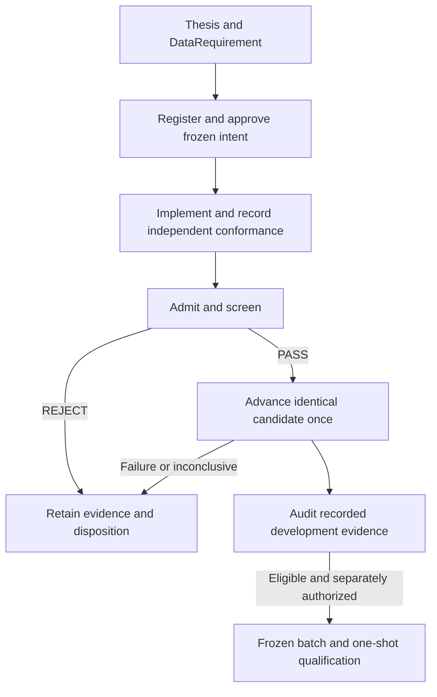

# Quant-Lab current research workflow

Current interface map for #109 and RG-01–09, checked against the review worktree
at `8fb7180` plus local governance fixes on 2026-11-27. This is a procedure,
not a claim that this branch is deployed. The
[target architecture](ARCHITECTURE.md) and [implementation plan](AGENT-CONTROL-PLAN.md)
describe future capabilities separately.

## Start with the question and the actual state

[AGENTS.md](../AGENTS.md) states ownership and invariants.
[AGENT_RUNBOOK.md](../AGENT_RUNBOOK.md) gives intake steps.
[RESEARCH-GOVERNANCE.md](RESEARCH-GOVERNANCE.md) defines the integrated intent,
candidate, operation, benchmark, novelty and exposure rules.
Use [CONTEXT-MAP.md](../CONTEXT-MAP.md) for task-specific deeper reading.

The principal provides an objective and scope through chat. The agent inspects,
prepares, executes authorized work and verifies effects. Commands below are
executor interfaces; the principal should receive a concrete decision packet
when a protected decision is necessary.

Before mutation, establish:

- Actual repository/worktree, branch, HEAD, dirty work and canonical ledger path.
- Active runtime identity separately from source checkout, when relevant.
- Current protected integrity/policy state, registered identities and receipts.
- Applicable candidate/lineage allowance, selection debt, prior outcomes and authority.

Use current metadata and recorded evidence. A dated report, empty-looking folder,
absent local database or remembered test count does not establish current state.
Preserve all concurrent work and sealed information.

## The current progression



Registration, candidate allowance, raw operations, statistical selection debt and
holdout exposure are different identities. See the [glossary](../CONTEXT.md).
A declared budget is a ceiling; the workflow may terminate at its first decisive failure.

## 1. Inspect integrity and resolve the data requirement

Current read interfaces include:

```bash
uv run --frozen warden check-worktree
uv run --frozen warden status --json
uv run --frozen warden resolve-data --requirement requirement.yaml --json
uv run --frozen python scripts/preflight_thesis.py --contract <CONTRACT_ID>
```

These examples require actual paths/IDs from the task. Do not copy placeholders
into an execution command.

Resolve the semantic [DataRequirement](DATA-REQUIREMENT.md) before choosing a
contract by name or writing strategy code. Preserve the thesis's universe,
frequency, information clock and execution basis. The signed
[venue policy](VENUE-POLICY.md) supplies costs, temporal boundaries and selection
group rules. An approved sandbox compilation is exploratory and non-qualifying.

Inspect exact contract/dataset/provenance identities and the resolver's eligibility
reason. No silent data substitution, synthetic quotes, future timestamps or
contract choice to avoid a gate. The exploratory fence covers the entire readable
artifact, including symbols later excluded from scoring.

A stale protected manifest blocks the affected integrity-gated scientific
commands. Diagnose the mismatch, preserve the diff and prepare the required
approval/release evidence; continue independently authorized engineering work.
Current signing authority remains unchanged. The proposed Release Authority is
not installed merely because its design is documented.

## 2. Freeze intent before candidate implementation

Use the canonical [hypothesis template](../.workspace/templates/hypothesis.md).
Record source evidence, economic mechanism/friction, falsification, timing,
capacity, prior-art/lessons disposition, data requirement, purpose, evaluation
criteria and allowed revisions.

Register the hypothesis and obtain the existing principal approval of the complete
research intent. For incremental work, bind the executable benchmark and comparative
policy before any candidate result. The full term sheet belongs in the intent's
`thesis` value; registration front matter alone is insufficient.

Use the exact RG-05/RG-06 schemas and commands in
[Research Governance](RESEARCH-GOVERNANCE.md#rg-05-frozen-research-intent-and-independent-conformance-124).
Approval of an engineering task is not approval of a scientific intent.

## 3. Implement and review the exact candidate

New active hypotheses use the causal protocols in
[protocols.py](../src/warden/protocols.py):
`CausalModelStrategy` or `CausalRulesStrategy`. ML4T owns execution and the
Warden kernel owns data access, causal verification and frozen evaluation.

Describe the candidate, review its actual code/config/data binding and the RG-07
prior-memory snapshot, and record independent conformance through the current
principal-controlled path. A missing or unavailable reviewer is not a PASS.
Keep the intent digest in the spec. Material revisions need the approved revision
key, predecessor and new binding/review, with applicable lineage debt retained.

Full code closure includes declared dynamic dependencies. Existing template,
linear-baseline, neighbor-stability and model-tier rules remain binding; do not
invent a generic parameter grid or present a fixed stress scenario as a selectable
free strategy.

## 4. Check receipts before scoring

```bash
uv run --frozen warden spec-status experiments/active/<spec>.yaml --json
uv run --frozen python scripts/preflight_trial.py experiments/active/<spec>.yaml
```

Metadata preflight does not import/run the candidate or produce Sharpe, PnL,
rankings or a scientific verdict. It does not admit an experiment.

| Recorded state | Current continuation |
|---|---|
| NEW | Proceed only after all intent, conformance, provenance and admission prerequisites hold |
| STAGE1_PASS | The same frozen candidate may advance once, without another screen |
| STAGE1_REJECT | Preserve the negative evidence; no forced backtest of that identity |
| STAGE3_FINAL or terminal hypothesis | Inspect/dispose recorded evidence; no replay to fill a report |
| REQUIRES_RECONCILIATION or uncertain receipt | Inspect existing effects; no refund or blind retry |

Use `attempt-status --run-id <ID> --json` for an uncertain full attempt.
Reconciliation may record interruption/review; it cannot restore consumed
scientific allowance.

## 5. Execute the eligible progression

After prospective prerequisites are satisfied:

```bash
uv run --frozen warden advance experiments/active/<spec>.yaml --json
```

The current `advance` command checks lifecycle/outcome memory and progresses
eligible work through verification, screen, full evaluation and audit.
It cannot approve an intent, substitute for independent conformance or unseal a
holdout. `advance --pending` uses the same rules for pending work.

Individual `verify`, `screen`, `backtest` and `audit-check` commands remain
available. A first full evaluation can include Stage 1; an already finalized
rejected screen cannot be bypassed by calling `backtest` directly.

The runner admits before scoring and finalizes evidence before reporting success.
The same frozen screen/full pair uses one selectable candidate slot; fixed
robustness and benchmark operations have separate receipts. Existing raw history,
interrupted attempts and inherited statistical floors are retained.

Stage 2/3 use `ml4t.backtest.Engine`. Analytical 1.5x costs, full 2x costs,
+1-bar latency, neighbor stability, trimmed returns, causal checks, family gates
and selection correction retain their current rules. For exact predicates, read
[gates.py](../src/warden/gates.py), [runner.py](../src/warden/runner.py),
[robustness.py](../src/warden/robustness.py) and
[incremental.py](../src/warden/incremental.py). This workflow does not duplicate
numeric thresholds that can drift from their owner.

## 6. Interpret and close from durable evidence

Read the recorded verdict, `failed_gates`, comparative evidence, receipt state and
current eligibility. `WARDEN_RUN_COMPLETE` or exit 0 is not scientific qualification.
A transport error does not establish that no attempt occurred.

Use the existing RG-07 closure path where appropriate: REJECTED, INCONCLUSIVE,
EXHAUSTED or EARLY_STOPPED have distinct evidence/authority requirements.
Preserve exact failures, incomplete receipts and debt. Proceed with other eligible
work within the objective; do not spend remaining slots merely because they exist.

Generate reports from canonical projections and immutable artifacts. Preserve
raw outputs as evidence references; summarize conclusions, limitations and next
decisions without manually transcribing metrics or copying a report script for
every new campaign.

## 7. Prepare qualification as a separate protected decision

Qualification requires the recorded development, audit, causal, code/data,
intent/conformance and exposure prerequisites. Incremental qualification requires
its frozen comparative PASS as well.

Follow RG-08's exact sequence: metadata-only batch description, evidence-based
historical exposure reconciliation, explicit frozen-batch authorization, and
separate explicit unseal authorization before execution. A promoted contract,
signed inventory or approved release alone cannot authorize a read.

Never open, hash, sample or permission-probe a sealed artifact to prepare a packet.
Unknown historical exposure remains unknown. An admitted claim is spent even if
execution fails before read-start. A scope incident blocks the affected future
qualification pending authorized reconciliation, with no information refund.

## Where to inspect an uncertainty

| Question | Owner/reference |
|---|---|
| Which stage/operation is eligible? | Current registry receipts, `spec-status`, `attempt-status`; [RG-03/04](RESEARCH-GOVERNANCE.md) |
| Which scientific rule failed? | Recorded `diagnostics_json["failed_gates"]`, comparative evidence and evaluator source |
| Is this old evidence reusable? | Frozen identities, [outcome memory](RESEARCH-OUTCOME-MEMORY-20261102.md), RG-07 novelty and lineage |
| Can this dataset/contract be used? | Resolver, [DataRequirement](DATA-REQUIREMENT.md), [promotion](SANDBOX-PROMOTION.md), provenance |
| Is an error retryable? | Admission/effect state first; [blocker recovery](BLOCKER-RECOVERY.md) |
| What is actually deployed? | Actual protected runtime/activation evidence; never branch HEAD alone |
| How will this become one coherent agent interface? | [Target architecture](ARCHITECTURE.md), [contracts](AGENT-CONTROL-CONTRACTS.md), [plan](AGENT-CONTROL-PLAN.md) |
